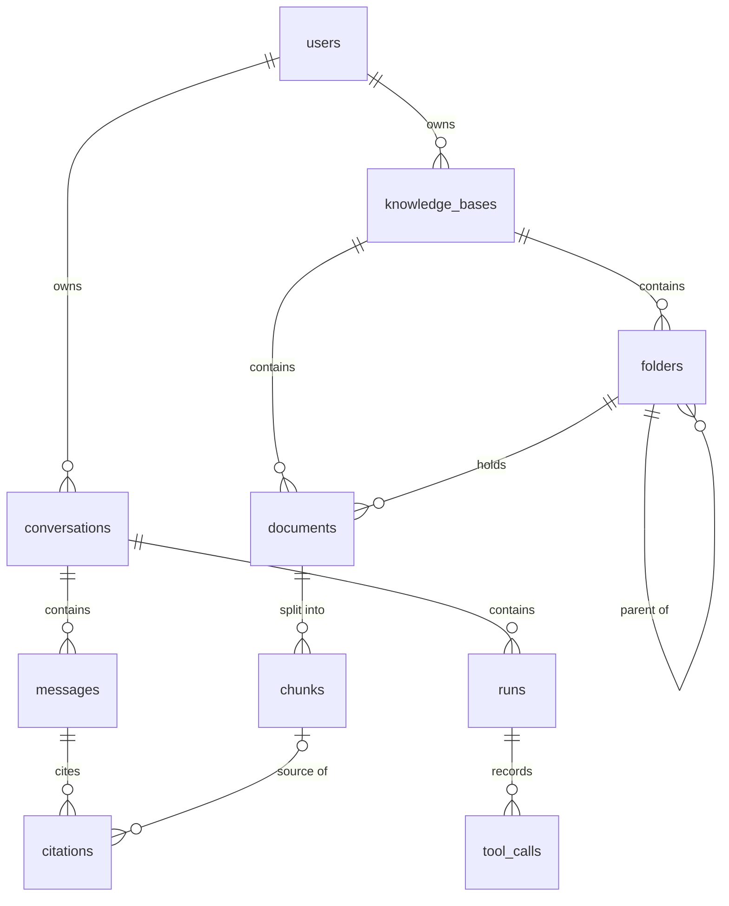

# 数据模型设计

本文描述后端 SQLite 数据库的 v1 模型。表结构定义在 [`backend/app/db.py`](../backend/app/db.py)，数据库版本记录在 `PRAGMA user_version` 中，当前为 `2`。

v1 一次性建好了 P0 需要的全部实体。其中会话、消息、运行、工具调用和引用五张表已经建好，但暂未被接口使用，等 Agent 循环实现时接入。

## 1. 实体关系

- **数据归属**：用户拥有知识库和会话。文件夹、文档和片段的归属都通过所在知识库确定，因此权限只需校验知识库的 `user_id`，不在每张表上重复存储用户字段。
- **目录树**：文件夹通过 `parent_id` 形成任意深度的树，`parent_id` 为空表示根目录。文档的 `folder_id` 为空表示直接放在知识库根目录下。
- **一次提问**：一次提问对应一条 `runs` 记录，它关联提问消息、回答消息和本次的所有工具调用。`runs.id` 同时作为日志和前端调用轨迹的关联标识。

## 2. 表结构

### 2.1 用户与知识库

| 表 | 关键字段 | 约束与说明 |
| --- | --- | --- |
| `users` | `id`、`name`、`username`、`password_hash` | 注册时生成 UUID 作为 `id`；`username` 大小写不敏感唯一；`password_hash` 为 scrypt 加盐哈希，v7 之前的老用户为空，需用 `python -m app.users set-password` 设置 |
| `sessions` | `id`、`user_id`、`token_hash`、`created_at`、`expires_at` | 登录会话；只存令牌的 SHA-256，随用户级联删除 |
| `knowledge_bases` | `id`、`user_id`、`name`、`created_at`、`updated_at` | `user_id` 外键；删除用户时级联删除其知识库 |
| `folders` | `id`、`knowledge_base_id`、`parent_id`、`name` | 同一父目录下名称唯一（根目录同样适用）；不能把自己设为父目录；删除知识库时级联删除 |

`folders` 只用 `CHECK` 约束阻止直接自环。更深层的循环（例如把 A 移动到 A 的子孙目录下）需要在移动接口中检查祖先链。

### 2.2 文档与片段

| 表 | 关键字段 | 约束与说明 |
| --- | --- | --- |
| `documents` | `knowledge_base_id`、`folder_id`、`filename`、`file_type`、`size_bytes`、`sha256`、`path`、`status`、`error`、`parse_mode`、`parser`、`page_count` | 同一知识库内 `sha256` 唯一，用于按内容去重；`status` 取值为 `queued`、`parsing`、`success`、`failed`；`file_type` 记录上传时识别的格式，重命名不影响解析器选择；`parse_mode` 为 `standard`（版面 + 表格）或 `enhanced`（另开 OCR），由用户选择；`parser` 记录产生当前片段的解析器与版本；`page_count` 仅 PDF（schema v5） |
| `chunks` | `document_id`、`ordinal`、`content`，以及下文的位置字段 | 同一文档内 `ordinal` 唯一；删除文档时级联删除 |

片段的来源位置使用带类型的字段存储，而不是一段展示文本，这样工具可以按范围读取原文，评测也可以判断引用位置是否正确：

| 字段 | 含义 |
| --- | --- |
| `loc_kind` | `txt_lines`、`pdf_page`、`docx_paragraphs`、`docx_table_rows` |
| `loc_start`、`loc_end` | 起止序号，从 1 开始，闭区间；单位由 `loc_kind` 决定，分别为行、页、段落、表格行 |
| `loc_table` | 表格序号（从 1 开始）：`docx_table_rows` 必填；来自表格的 `pdf_page` 片段也填写 |
| `heading_path` | 所属标题路径，JSON 数组，例如 `["第一章","1.1 小节"]` |
| `char_start`、`char_end` | 仅 TXT 的超长行被拆成多个片段时填写，表示在该行内的字符范围（从 0 开始，左闭右开）；Docling 分块不提供可靠的字符范围，为空 |
| `elements` | 片段来源元素，JSON 数组 `[{ref, label, page, bbox}]`：`ref` 为 Docling `self_ref`（TXT 为 `line:N`），`page` 从 1 开始，`bbox` 为 `[x0,y0,x1,y1]`，左上原点，按页宽高归一化到 0–1；DOCX/TXT 没有页面几何，`page`、`bbox` 为空。按 `(ref, page)` 去重，最多 64 项（schema v5） |

接口返回的 `location` 对象包含以上字段，以及由它们生成的展示文本 `label`，例如 `第一章 › 1.1 小节 › 第 4–6 段`、`表 1 第 2 行`、`合并资产负债表 › 表 2 第 5–6 页`、`第 3 行，字符 601–1200`。

解析产物（Markdown `document.md` 与 Docling 结构 JSON `document.json`）不入库，保存在 `{PK_DATA_DIR}/artifacts/{document_id}/`，随文档删除。

### 2.3 对话与调用轨迹（为 Agent 预留）

| 表 | 关键字段 | 约束与说明 |
| --- | --- | --- |
| `conversations` | `user_id`、`title` | 删除用户时级联删除 |
| `messages` | `conversation_id`、`role`、`content`、`status`、`error` | `role` 为 `user` 或 `assistant`；`status` 为 `streaming`、`completed`、`failed` |
| `runs` | `conversation_id`、`user_message_id`、`assistant_message_id`、`knowledge_base_ids`、`status`、`stop_reason`、`step_count`、`model`、token 用量、`started_at`、`finished_at` | `knowledge_base_ids` 记录本次实际使用的检索范围（JSON 数组）；`stop_reason` 为 `answered`、`max_steps`、`model_error`、`timeout`、`interrupted` |
| `tool_calls` | `run_id`、`step`、`tool_name`、`arguments`、`status`、`result_summary`、`error_code`、`error_message`、`retryable`、`duration_ms` | 一次运行中的每次工具调用一行；`step` 表示第几轮模型决策 |
| `citations` | `message_id`、`marker`、`chunk_id`、`document_id`、`filename`、`location_label`、`content` | 同一消息内 `marker` 唯一 |

引用保存了文件名、位置和原文快照。原因是重新解析会生成新的片段 ID，删除文档也会删除片段，但历史回答仍需要显示当时引用的内容。因此 `chunk_id` 和 `document_id` 设为 `ON DELETE SET NULL`：来源被删除后，引用退化为只读快照，不会连带删除回答。

## 3. 删除与一致性规则

| 操作 | 数据库行为 | 应用层补充 |
| --- | --- | --- |
| 删除文档 | 级联删除片段；引用中的片段和文档 ID 置空 | 删除原文件；解析任务写入片段前在写锁内确认文档仍存在，防止删除后写回 |
| 删除知识库 | 级联删除文件夹、文档、片段 | 需逐个删除原文件（接口待实现） |
| 删除文件夹 | 级联删除子文件夹和其中的文档 | 接口应先确定非空目录的规则（拒绝或递归删除） |
| 服务重启 | — | 启动时将 `queued`、`parsing` 的文档标记为失败并允许重试；将 `running` 的运行和 `streaming` 的消息标记为中断 |

## 4. 片段切分规则

| 格式 | 基本单元 | 合并规则 |
| --- | --- | --- |
| TXT | 非空行 | 连续行合并，直到约 800 字符 |
| PDF | 页 | 不跨页合并 |
| DOCX 正文 | 段落 | 同一标题路径下的连续段落合并；标题段落本身计入所在小节 |
| DOCX 表格 | 表格行 | 同一表格内的连续行合并 |

单个单元超过 800 字符时，按 800 字符窗口、200 字符重叠拆分，并记录字符范围。TXT 依次尝试 UTF-8（含 BOM）和 GB18030（兼容 GBK）解码，都失败时解析失败并提示转换编码。

## 5. 版本迁移

- 启动时读取 `PRAGMA user_version`，按顺序执行未完成的迁移。每次迁移在单个事务中完成，提交前执行外键校验，失败时整体回滚。
- 数据库版本高于程序支持的版本时拒绝启动，避免旧程序写坏新数据。
- **v0 → v1**：首日原型的数据库没有版本号。迁移时保留知识库（归属到 `demo` 用户）、文档记录和原文件。旧片段的位置是展示文本，无法可靠地转成结构化字段，因此会删除旧片段，并把文档标记为失败，提示“数据模型已升级，请重新解析”，用户点击重试即可重建片段。原文件缺失的文档会提示删除后重新上传。
- **v1 → v2**：只做 `ALTER TABLE ADD COLUMN`，为 Agent 轨迹补充字段：`tool_calls.result_json`（截断后的结构化工具结果）、`runs.dropped_citations`（模型引用了但本次工具未返回的标记，JSON 数组，默认 `[]`）、`citations.location_json`（结构化来源位置）。
- 后续字段变更应新增迁移函数并提升版本号，不能修改已发布的迁移。

### v3：稠密向量持久化

新增 `chunk_embeddings(chunk_id PRIMARY KEY, profile, dimensions, vector)`。
`chunk_id` 外键指向 `chunks.id`，删除片段时级联删除。`vector` 为归一化后的
小端 float32 BLOB，长度必须等于 `dimensions * 4`；`profile` 为服务地址、模型、
维度和手动 revision 的 SHA-256，不包含 API Key。

v2 → v3 仅新增表，原文和成功状态不变，迁移过程不调用模型。旧数据需显式执行
`python -m app.reindex --username <用户名>`。向量与片段在同一个数据库中，无新增
`vectors/` 目录；当前执行精确余弦扫描，适用于小规模本地应用，不是 ANN。
