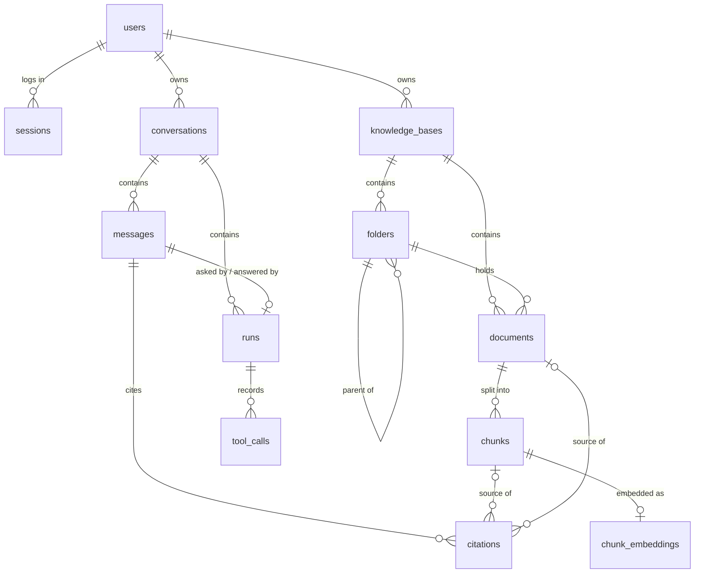

# 数据模型设计

本文描述 KnowledgePilot 的持久化模型：SQLite 数据库 `{PK_DATA_DIR}/knowledge.db` 的表结构、约束、删除规则与版本迁移，以及数据库之外的文件存储。表结构定义在 [`backend/app/db.py`](../backend/app/db.py)，当前 schema 版本为 **7**（记录在 `PRAGMA user_version`）。

## 1. 存储总览

| 存储 | 位置 | 内容 |
| --- | --- | --- |
| 关系数据库 | `{PK_DATA_DIR}/knowledge.db`（WAL 模式，外键开启） | 用户与登录会话、知识库、目录、文档、片段、片段向量、会话、消息、运行、工具调用、引用 |
| 原文件 | `{PK_DATA_DIR}/uploads/` | 用户上传的原始文件，供重新解析、下载与 PDF 渲染 |
| 解析产物 | `{PK_DATA_DIR}/artifacts/{document_id}/` | `document.md`（Markdown 导出）、`document.json`（Docling 结构化文档，TXT 无） |

向量与片段存放在同一个数据库中：片段与向量在同一事务内写入，删除片段时由外键级联删除向量，不存在独立索引与数据不一致的问题。

## 2. 实体关系

设计要点：

- **归属只存一处**：用户直接拥有知识库与会话；目录、文档、片段、向量的归属都经所在知识库推导。权限校验只需检查 `knowledge_bases.user_id`，避免多张表的用户字段不一致。
- **目录树**：`folders.parent_id` 自引用，`NULL` 表示知识库根目录，深度不限。文档的 `folder_id` 为 `NULL` 表示位于根目录。
- **一次提问 = 一条 `runs`**：关联提问消息、回答消息和该次全部工具调用。`runs.id` 同时是日志中的 `run_id` 和前端轨迹的查询键。
- **引用是快照**：引用保存文件名、位置和原文，来源被删除或重新解析后历史回答仍可展示。

## 3. 表结构

### 3.1 用户与登录会话

| 表 | 字段 | 约束与说明 |
| --- | --- | --- |
| `users` | `id` TEXT PK、`name`、`username`、`password_hash`、`created_at` | 新用户 `id` 为 UUID；`username` 大小写不敏感唯一（`idx_users_username … COLLATE NOCASE`）；`password_hash` 为 `scrypt$N$r$p$salt$hash`，为空表示尚未设置密码、不能登录 |
| `sessions` | `id` PK、`user_id` → users（CASCADE）、`token_hash` UNIQUE、`created_at`、`expires_at` | 只存会话令牌的 SHA-256；固定到期，不滑动续期；随用户级联删除 |

### 3.2 知识库与目录

| 表 | 字段 | 约束与说明 |
| --- | --- | --- |
| `knowledge_bases` | `id` PK、`user_id` → users（CASCADE）、`name`、`created_at`、`updated_at` | 索引 `(user_id)` |
| `folders` | `id` PK、`knowledge_base_id` → knowledge_bases（CASCADE）、`parent_id` → folders（CASCADE）、`name`、时间戳 | `CHECK (parent_id <> id)` 禁止直接自环；唯一索引 `(knowledge_base_id, COALESCE(parent_id,''), name)` 保证同一父目录（含根目录）下名称唯一 |

更深层的循环（把目录移动到自己的子孙目录下）无法用约束表达，由移动接口在写锁内沿祖先链检查（见[系统设计文档 §5.2](design.md#52-知识库目录与文件)）。

### 3.3 文档、片段与向量

| 表 | 字段 | 约束与说明 |
| --- | --- | --- |
| `documents` | `id` PK、`knowledge_base_id` → knowledge_bases（CASCADE）、`folder_id` → folders（CASCADE）、`filename`、`file_type`、`size_bytes`、`sha256`、`path`、`status`、`error`、`parse_mode`、`parser`、`page_count`、时间戳 | `UNIQUE (knowledge_base_id, sha256)` 实现同库按内容去重；`file_type ∈ {txt, pdf, docx}`，上传时确定，重命名不影响；`status ∈ {queued, parsing, success, failed}`；`parse_mode ∈ {standard, enhanced}`；`parser` 记录生成当前片段的解析器与版本；`page_count` 仅 PDF |
| `chunks` | `id` PK、`document_id` → documents（CASCADE）、`ordinal`、`content`、位置字段（见下表）、`elements` | `UNIQUE (document_id, ordinal)`；位置字段带 CHECK 约束 |
| `chunk_embeddings` | `chunk_id` PK → chunks（CASCADE）、`profile`、`dimensions`、`vector` | `vector` 为 L2 归一化后的小端 float32 BLOB，`CHECK (length(vector) = dimensions * 4)`；`profile` 为向量配置签名（服务地址、模型、维度、revision、输入格式版本的 SHA-256，不含密钥） |

**片段位置字段**。位置以带类型的结构化字段保存，而不是展示文本，使工具可以按范围读取原文、评测可以判断引用位置是否正确：

| 字段 | 含义 |
| --- | --- |
| `loc_kind` | `txt_lines`、`pdf_page`、`docx_paragraphs`、`docx_table_rows` |
| `loc_start`、`loc_end` | 起止序号，从 1 开始，闭区间，`loc_end ≥ loc_start`；单位由 `loc_kind` 决定：行、页、段落（文本元素阅读顺序号）、表格行 |
| `loc_table` | 表格序号（从 1 开始）：`docx_table_rows` 必填，来自表格的 `pdf_page` 片段也填写 |
| `heading_path` | 所属标题路径，JSON 数组，如 `["第一章","1.1 小节"]` |
| `char_start`、`char_end` | 仅 TXT 超长行被拆分时填写：行内字符范围，左闭右开；二者同时为空或同时非空 |
| `elements` | 来源元素 JSON 数组 `[{ref, label, page, bbox}]`。`ref` 为 Docling `self_ref`（TXT 为 `line:N`）；`page` 从 1 开始；`bbox = [x0,y0,x1,y1]`，左上原点、按页宽高归一化到 0–1。DOCX/TXT 的 `page`、`bbox` 为空。按 `(ref, page)` 去重，最多 64 项 |

接口返回的 `location` 对象包含上述字段及由其生成的展示文本 `label`，例如 `第一章 › 1.1 小节 › 第 4–6 段`、`表 1 第 2 行`、`合并资产负债表 › 表 2 第 5–6 页`、`第 3 行，字符 601–1200`。

### 3.4 会话、运行与轨迹

| 表 | 字段 | 约束与说明 |
| --- | --- | --- |
| `conversations` | `id` PK、`user_id` → users（CASCADE）、`title`、时间戳 | 索引 `(user_id, updated_at)` |
| `messages` | `id` PK、`conversation_id` → conversations（CASCADE）、`role`、`content`、`status`、`error`、`scope_json`、`created_at` | `role ∈ {user, assistant}`；`status ∈ {streaming, completed, failed}`；`scope_json` 为该轮资料范围快照 `{selection, labels, knowledge_base_ids, document_ids}`，同一轮的提问与回答保存同一快照 |
| `runs` | `id` PK、`conversation_id`（CASCADE）、`user_message_id`（CASCADE）、`assistant_message_id`（SET NULL）、`knowledge_base_ids`、`status`、`stop_reason`、`step_count`、`model`、`prompt_tokens`、`completion_tokens`、`error`、`dropped_citations`、`degraded`、`model_retries`、`started_at`、`finished_at` | `status ∈ {running, completed, failed}`；`stop_reason ∈ {answered, max_steps, model_error, timeout, interrupted}`；`knowledge_base_ids` 为实际使用的范围（JSON 数组）；`dropped_citations` 为模型写出但本次工具未返回的标记（JSON 数组）；`degraded` 表示发生过重试或降级 |
| `tool_calls` | `id` PK、`run_id` → runs（CASCADE）、`step`、`tool_name`、`arguments`、`status`、`result_summary`、`result_json`、`error_code`、`error_message`、`retryable`、`duration_ms`、`attempt`、`retry_of`、`fallback`、`created_at` | `status ∈ {running, success, error}`；`step ≥ 1` 为第几轮模型决策；`result_json` 为截断到 8000 字符的结构化结果；自动重试是独立的一行，`attempt=2` 且 `retry_of` 指向首次调用；`fallback` 为降级类型（`bm25`、`retrieved_snippets`） |
| `citations` | `id` PK、`message_id` → messages（CASCADE）、`marker`、`chunk_id` → chunks（SET NULL）、`document_id` → documents（SET NULL）、`filename`、`location_label`、`location_json`、`content` | `UNIQUE (message_id, marker)`；保存文件名、结构化位置与原文快照 |

## 4. 删除与一致性规则

| 操作 | 数据库行为 | 应用层补充 |
| --- | --- | --- |
| 删除文档 | 级联删除片段与向量；引用的 `chunk_id`、`document_id` 置空，快照保留 | 提交后删除原文件与解析产物；重复删除返回 204 |
| 删除目录 | 级联删除子目录、其中文档、片段与向量 | 非空目录需显式 `recursive=true`；提交后删除涉及的原文件与产物 |
| 删除知识库 | 级联删除目录、文档、片段与向量 | 提交后逐个删除原文件与产物；单个文件删除失败记录告警，不回滚 |
| 删除会话 | 级联删除消息、运行、工具调用、引用 | — |
| 删除用户 | 级联删除登录会话、知识库及其全部内容、会话 | 删除磁盘文件；不可恢复 |
| 写入解析结果 | 在 `BEGIN IMMEDIATE` 写锁内先确认文档仍存在，再替换片段、向量、状态 | 文档已被删除则丢弃结果；解析产物在同一写锁内由临时目录原子重命名为正式目录 |
| 服务启动 | 将 `queued`、`parsing` 文档标记为 `failed`（可重试）；`running` 的运行标记为 `failed / interrupted`；`streaming` 消息标记为 `failed` | 清理残留的产物临时目录 |

引用的外键使用 `ON DELETE SET NULL` 而不是 `CASCADE`：删除资料不应连带删除历史回答，来源消失后引用退化为只读快照。

## 5. 片段切分规则

| 格式 | 切分方法 | 位置类型 |
| --- | --- | --- |
| PDF | Docling 版面分析后由 HybridChunker 按文档结构切分，以 BGE-M3 分词器计数，默认上限 512 token；表格序列化为 Markdown 表格，拆块时重复表头 | `pdf_page`（起止页，可带表格序号） |
| DOCX | 同 PDF；文本元素按阅读顺序编号 | `docx_paragraphs` 或 `docx_table_rows` |
| TXT | 依次尝试 UTF-8（含 BOM）与 GB18030 解码，均失败则解析失败；连续非空行合并到约 800 字符；单行超过 800 字符时按 800 字符窗口、200 字符重叠拆分并记录字符范围 | `txt_lines` |

向量与词法检索的输入均为“标题路径 + 片段正文”，`SearchHit.content` 返回原文正文。

## 6. 版本迁移

- 启动时读取 `PRAGMA user_version`，按顺序执行未完成的迁移。每个版本在单个 `BEGIN IMMEDIATE` 事务内执行，提交前运行 `PRAGMA foreign_key_check`，任一步失败整体回滚。
- 数据库版本高于程序支持的版本时拒绝启动，防止旧程序写坏新数据。
- 已发布的迁移不再修改；结构变更新增迁移函数并提升版本号。除 v1 外，所有迁移只新增表或列，不改写已有数据。
- Web 应用执行“迁移 + 中断恢复”；MCP Server 等辅助进程只执行迁移，不重置 Web 应用正在进行的任务。

| 版本 | 变更 |
| --- | --- |
| v1 | 建立全部核心表：用户、知识库、目录、文档、片段（结构化位置）、会话、消息、运行、工具调用、引用。无版本号的旧库：知识库归属 `demo` 用户，文档保留原文件并标记为需重新解析 |
| v2 | `tool_calls.result_json`、`runs.dropped_citations`、`citations.location_json` |
| v3 | 新增 `chunk_embeddings` |
| v4 | `tool_calls.attempt / retry_of / fallback`、`runs.degraded / model_retries`（重试与降级轨迹） |
| v5 | `documents.parse_mode / parser / page_count`、`chunks.elements`（结构化解析与来源元素） |
| v6 | `messages.scope_json`（每轮资料范围快照） |
| v7 | `users.username / password_hash`、新增 `sessions`（用户名密码登录）。已有用户保留 `id` 与数据，`username` 取原 `id`，需用 `python -m app.users set-password` 设置密码后登录 |

切换到向量或混合检索、或更换 Embedding 模型后，已有文档的向量通过 `python -m app.reindex --username <用户名>` 重建；重建保留片段 ID，历史引用不受影响。
