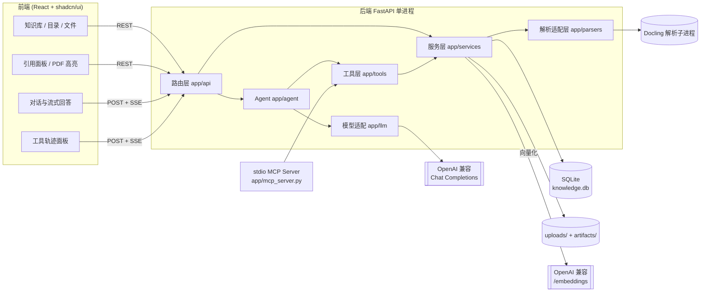
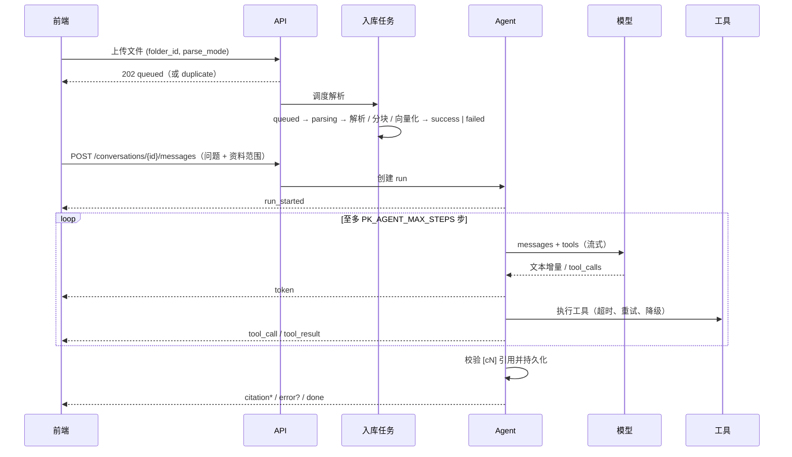
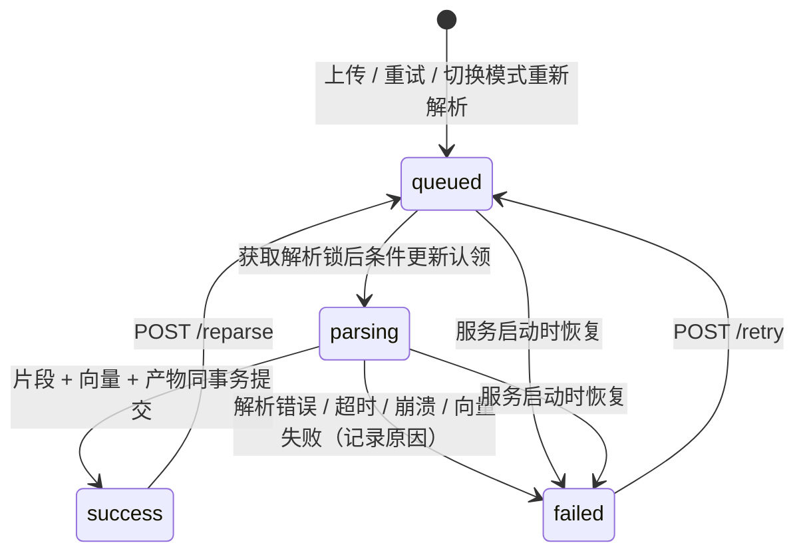

# KnowledgePilot 系统设计文档

## 1. 引言

### 1.1 目的

本文描述 KnowledgePilot（个人知识管理智能助手）的系统设计，包括总体架构、前后端技术选型及其取舍、各模块的详细设计、关键算法与非功能设计，作为开发、评审与维护的依据。

### 1.2 范围

KnowledgePilot 是一个本地运行的个人知识库智能助手：用户创建多个知识库并按目录管理文档，系统异步解析 PDF / Word / TXT 并建立索引；提问时由大模型自主调用“检索片段、列出文件、读取原文、列出知识库”等工具取证，流式输出带引用的回答，并展示完整的工具调用轨迹。同一套工具通过本地 stdio MCP Server 暴露给外部 AI 客户端。

### 1.3 术语

| 术语 | 含义 |
| --- | --- |
| 知识库（KB） | 用户拥有的文档集合，是检索与权限的基本边界 |
| 片段（chunk） | 文档解析后切分出的最小检索单元，带结构化来源位置 |
| 运行（run） | 一次提问对应的一次 Agent 执行：多轮模型决策、工具调用与最终回答 |
| 引用标记 | 回答中的 `[c1]`、`[c2]`，对应本次运行中工具返回过的片段 |
| 资料范围（scope） | 一次提问允许使用的知识库 / 目录 / 文档集合 |
| 降级 | 工具或模型失败时，以有限重试或替代结果继续完成回答，并显式标注 |
| RRF | Reciprocal Rank Fusion，按名次融合多路检索结果的方法 |

### 1.4 参考文档

| 文档 | 内容 |
| --- | --- |
| [功能需求](README.md) | 需求清单与验收要点 |
| [接口契约](contracts.md) | HTTP 接口、错误码、SSE 事件、工具定义、Agent 与降级规则 |
| [数据模型设计](data-model.md) | 表结构、约束、删除规则、版本迁移 |
| [后端开发说明](backend.md) | 启动、配置、命令行工具、测试 |
| [评测报告](eval-report.md)、[评测说明](../eval/README.md) | 评测集、指标与结果 |
| [Skill 包](../skills/knowledgepilot/) | `SKILL.md`、MCP 客户端配置与调用示例 |

---

## 2. 需求概述

### 2.1 功能需求

| 编号 | 需求 |
| --- | --- |
| F1 | 多知识库，按用户隔离；任意层级目录；文件上传、删除、重命名、移动 |
| F2 | PDF / Word / TXT 解析入库；排队 / 解析中 / 成功 / 失败（含原因）状态；可重试；按内容去重；片段带来源位置；删除文档同步清理索引 |
| F3 | 按一个或多个知识库检索，返回内容、来源、位置与相关度，去重排序 |
| F4 | 至少 3 个工具（检索片段、列出文件、读取原文），有清晰说明、参数约束和结构化错误 |
| F5 | 模型自主选择工具、限制最大步数、多轮对话与指代消解、流式回答、引用可追溯、工具轨迹可见 |
| F6 | 自实现前端，覆盖知识库与文件管理、提问、流式回答、引用与轨迹 |
| F7 | 扩展能力：多文档对比、工具失败降级、引用聚合、MCP + Skill 暴露、评测集 |

### 2.2 非功能需求与约束

| 类别 | 要求 |
| --- | --- |
| 部署 | 一条命令本地启动，不依赖外部基础设施；重启后数据不丢 |
| 模型 | 使用公开 API 或本地部署模型（OpenAI 兼容接口）；密钥只来自环境变量 |
| 安全 | 用户数据隔离；日志不输出密钥与文档全文；工具结果视为不可信数据 |
| 可靠性 | 后台任务异常不影响服务；任务不会长期停留在中间状态；上传、重试、删除幂等 |
| 可观测性 | 结构化日志；请求与提问可通过 ID 关联到工具调用记录 |
| 可测试性 | 核心流程有自动化测试，测试不依赖网络和模型密钥 |
| 依赖 | 不引入 Redis、消息队列、向量数据库服务等大型依赖 |

---

## 3. 总体设计

### 3.1 设计原则

| 原则 | 落地方式 |
| --- | --- |
| **能力工具化** | 知识库能力封装为带 JSON Schema 的工具，应用内 Agent 与 MCP Server 共用一份工具注册表 |
| **证据可追溯** | 片段保存结构化位置（页 / 行 / 段落 / 表格 + 归一化坐标框）；引用只接受本次工具实际返回的片段，并保存原文快照 |
| **过程可观测** | 每次提问对应一个 run；工具调用逐条持久化并经 SSE 实时推送；日志携带 `request_id` / `run_id` |
| **失败可解释** | 统一结构化错误；可重试错误有限重试；替代结果显式标注；模型异常明确结束 |
| **最小依赖** | 单进程 + SQLite + 本地文件；重型解析放入子进程隔离 |

### 3.2 系统架构



### 3.3 分层与模块划分

调用方向严格为 路由 → 服务 → 数据库。Agent、工具层与 MCP 只调用服务层，不直接拼接 SQL；解析器、检索器、模型客户端均通过接口抽象，测试时可注入替身，评测时可切换实现。

| 层 | 目录 | 职责 |
| --- | --- | --- |
| 路由层 | `app/api/` | 参数校验、认证依赖、HTTP 状态码、SSE 响应 |
| Agent 层 | `app/agent/` | 模型决策循环、上下文组装、引用校验、SSE 帧 |
| 工具层 | `app/tools/` | 工具定义、参数校验、范围检查、降级、结果序列化 |
| 服务层 | `app/services/` | 业务规则与短事务：认证、权限、文档、检索、向量、会话 |
| 解析层 | `app/parsers/` | Parser 接口、TXT 解析、Docling 子进程与结构映射 |
| 模型层 | `app/llm/` | `LLMClient` 协议与 OpenAI 兼容实现（流式工具调用） |
| 基础设施 | `main / config / db / errors / schemas / deps / logging_setup` | 应用装配、配置、迁移、错误、接口模型、日志 |
| MCP | `app/mcp_server.py` | stdio 协议适配，复用工具注册表 |
| 命令行 | `app/users.py`、`app/reindex.py`、`app/parsers/prefetch.py` | 账号管理、向量重建、解析模型预下载 |

### 3.4 部署视图

`./start.sh` 依次检查 uv / npm、安装前端依赖（首次）、构建前端、启动 `uvicorn app.main:app`。FastAPI 在 `/` 托管 `frontend/dist`，接口位于 `/api/*`，OpenAPI 文档位于 `/docs`。

| 进程 | 说明 |
| --- | --- |
| Web 进程 | FastAPI + Uvicorn，单 worker；承载 HTTP、SSE、Agent 运行与后台入库任务 |
| 解析子进程 | 由 Web 进程以 spawn 方式按需拉起，独占 Docling；超时或崩溃时被终止并在下一个任务时重建 |
| MCP 进程 | 由 MCP 客户端以 stdio 拉起，与 Web 进程共享同一数据目录（SQLite WAL） |

数据目录 `backend/data/` 存放数据库、原文件与解析产物；配置与密钥位于 `backend/.env`。

### 3.5 核心业务流程



---

## 4. 技术选型

选型遵循三个标准：满足一条命令本地运行与“不引入大型依赖”的约束；关键行为（Agent 循环、降级、引用校验）完全可控、可测试；为规模增长保留清晰的替换路径。

### 4.1 后端

| 领域 | 选择 | 理由 | 代价与替代方案 |
| --- | --- | --- | --- |
| 语言与依赖管理 | Python 3.11+，uv | 文档解析、向量、MCP SDK 生态集中在 Python；uv 锁文件保证环境可复现 | Web 层并发性能一般，但系统瓶颈在模型与解析 |
| Web 框架 | FastAPI + Uvicorn | Pydantic 校验与 OpenAPI 文档自动生成；原生 async 适合 SSE 与模型流式 | 替代：Flask（无原生 async）、Django（过重） |
| 数据库 | SQLite（WAL、外键约束、`user_version` 迁移） | 零运维、单文件持久化；片段、向量、会话可在同一事务中提交与级联删除 | 单写者；多用户并发场景迁移到 PostgreSQL + pgvector |
| 向量存储 | SQLite 表内 float32 BLOB，精确内积扫描 | 无需独立向量数据库；与片段同事务提交，删除级联，无索引残留 | O(N) 扫描，适合万级片段；规模增长后改用 sqlite-vec、FAISS 或 pgvector 的 ANN |
| 文件存储 | 本地 `uploads/` 与 `artifacts/{doc_id}/` | 原文件可回看、PDF 可跳页高亮；产物原子替换 | 替代：对象存储（S3 / MinIO） |
| PDF / DOCX 解析 | Docling：版面分析 + TableFormer 表格结构 + 可选 RapidOCR | 报告类 PDF 表格密集，纯文本抽取会丢失表格结构；Docling 提供元素级出处（页码 + 坐标框），支撑引用跳页高亮 | 安装体积约 1 GB、模型约 0.7 GB，解析较慢，以子进程隔离；替代：PyMuPDF / pdfplumber（快但无版面模型）、MinerU、Unstructured |
| TXT 解析 | 自研轻量解析器 | 编码探测与行号定位简单可控 | — |
| 分块 | Docling HybridChunker，BGE-M3 分词器计 token | 按标题与表格边界切分，块大小与向量模型计数一致；表格输出为 Markdown 并重复表头 | — |
| 检索 | 词频余弦 / BM25 / BGE-M3 稠密向量 / BM25 + 向量 RRF 混合，配置切换 | 无密钥基线可用于测试；向量解决同义与跨语言；BM25 保留编号、金额、条款号等精确匹配；RRF 无需分数归一化 | RRF 对单路召回结果压分（§8.4）；替代：交叉编码器重排 |
| Embedding | OpenAI 兼容 `/embeddings`，默认 BGE-M3（1024 维） | 中英多语、长输入；本地（Ollama、vLLM、TEI）与云端均可接入 | 只使用 dense 输出 |
| 聊天模型接入 | OpenAI 兼容 Chat Completions + tools，自研 httpx 客户端 | 覆盖公开 API 与本地部署；直接解析流式 `delta.tool_calls` | 替代：官方 SDK、LangChain |
| Agent 编排 | 自研循环 | 精确控制步数、重试预算、降级标记、取消时持久化与事件顺序 | 替代：LangGraph、OpenAI Agents SDK |
| 后台任务 | BackgroundTasks + 单线程解析队列 + spawn 子进程 | 无需 Celery / Redis；子进程隔离原生代码崩溃与内存占用，超时可直接终止 | 进程内队列，重启后中断任务需手动重试；替代：持久任务队列 + 独立 worker |
| MCP | 官方 Python SDK `mcp`，stdio | 与应用内 Agent 共用工具注册表，行为完全一致 | — |
| 认证 | 用户名 + 密码；标准库 scrypt；HttpOnly Cookie 会话 | 无新增依赖；Cookie 对 SSE 请求透明 | 无找回密码与角色；替代：OAuth / OIDC |
| 日志 | 标准 logging JSON 输出 + `contextvars` 注入 ID | 请求、运行、工具调用可关联 | 替代：OpenTelemetry |
| 质量工具 | pytest、Ruff | 测试替身只存在于 `tests/`，经依赖注入使用 | — |

### 4.2 前端

| 领域 | 选择 | 理由 | 替代方案 |
| --- | --- | --- | --- |
| 构建 | Vite + TypeScript（strict） | 开发服务器启动快、代理后端；产物由 FastAPI 托管，保持单进程部署 | Next.js（需要 Node 服务端） |
| UI 框架 | React 19 | 生态成熟，流式状态适合 reducer 建模 | Vue |
| 组件与样式 | shadcn/ui（Radix 原语）+ Tailwind CSS v4，语义色变量，支持深色模式 | 组件源码可控，可访问性由 Radix 保证，无运行时主题库 | Ant Design / MUI（定制成本高、体积大） |
| Markdown | react-markdown + remark-gfm + 自研 `remarkCitations` 插件 | 在语法树层把 `[cN]` 转为引用徽标，不破坏表格、代码与链接 | 正则替换 HTML（不安全，易破坏结构） |
| PDF 查看 | pdfjs-dist | 渲染原始 PDF，按归一化坐标叠加证据高亮 | 仅显示文本快照（无法核对版面） |
| 流式通信 | `fetch` + `ReadableStream` 自研 SSE 解析 | 需要 POST 请求体与 Cookie，原生 `EventSource` 只支持 GET | `@microsoft/fetch-event-source` |
| 状态管理 | React Context + `useReducer` | 状态集中在“当前运行”和“资料范围”，无需全局状态库 | Zustand / Redux |
| 测试与检查 | Vitest + Testing Library + jsdom，oxlint | 与 Vite 配置同源 | Jest、ESLint |

---

## 5. 模块详细设计

### 5.1 认证与数据隔离

- **认证**：注册 / 登录成功后生成随机令牌写入 HttpOnly Cookie `kp_session`，数据库 `sessions` 只保存令牌的 SHA-256，固定有效期（默认 30 天）。密码以 scrypt（N=2^14, r=8, p=1, 16 字节盐）哈希保存。同一用户名 15 分钟内失败 5 次返回 429；用户不存在时同样执行一次哈希计算，避免通过响应时间探测用户名。修改密码后注销该用户其他会话。
- **归属校验**：用户直接拥有知识库与会话；目录、文档、片段的归属经所在知识库推导，统一由 `services/access.py` 的 `require_knowledge_base(s)`、`require_document`、`require_folder` 校验。访问他人资源一律返回 404，不泄露资源是否存在。
- **提问范围**：除用户归属外，工具层还校验“本次提问允许的范围”（`allowed_kb_ids`、`allowed_document_ids`），越界返回 `out_of_scope`。范围在提问开始时由 `services/chat_scope.resolve_scope` 一次解析为快照（自动 / 知识库 / 目录含子目录 / 指定文档的并集），并随消息持久化。

### 5.2 知识库、目录与文件

- **任意层级目录**：`folders.parent_id` 自引用成树；同一父目录（含根目录）下名称唯一。
- **移动防环**：在 `BEGIN IMMEDIATE` 写锁内，从目标父目录沿祖先链向上遍历，遇到被移动目录本身则拒绝（409 `folder_cycle`）。先加锁后检查，避免并发移动互相成环。
- **删除**：非空目录需显式 `recursive=true`；数据库级联删除子目录、文档、片段与向量，事务提交后删除原文件与解析产物。所有删除幂等。
- **重命名与移动文件**：仅修改 `filename` / `folder_id`，片段与引用不受影响；`file_type` 在上传时确定，重命名不改变解析器选择。文件移动限于同一知识库，避免跨库移动带来的索引归属与权限重建。

### 5.3 解析入库



| 设计点 | 实现 |
| --- | --- |
| 内容去重 | 上传时计算 SHA-256，`UNIQUE (knowledge_base_id, sha256)`；命中返回已有记录并标记 `duplicate: true`。并发插入撞上唯一约束时再查询返回已有记录。去重限于同一知识库，不影响用户隔离与多库归属 |
| 单任务约束 | 认领使用条件更新 `UPDATE … SET status='parsing' WHERE id=? AND status='queued'`，重复点击重试不会产生并发任务 |
| 进程隔离 | PDF/DOCX 交给单个 spawn 子进程（`parsers/worker.py`），Web 进程不导入 Docling；一次解析一份，其余保持 `queued`；超过 `PK_PARSE_TIMEOUT`（默认 30 分钟）终止子进程并标记失败；子进程崩溃同样转为失败；父进程退出时子进程自行退出 |
| 解析模式 | `standard`：版面分析 + TableFormer ACCURATE，关闭 OCR；`enhanced`：另开 RapidOCR 整页识别，适用于扫描件。已解析文档可切换模式重新解析 |
| 删除竞态 | 写入片段前在 `BEGIN IMMEDIATE` 写锁内确认文档仍存在，已删除则丢弃结果 |
| 原子提交 | 片段、向量、状态同一事务写入；产物先写入临时目录，在同一写锁内重命名为正式目录，重命名失败则整体回滚；启动时清理残留临时目录 |
| 启动恢复 | `queued` / `parsing` 文档标记为失败并提示重试；`running` 运行与 `streaming` 消息标记为中断 |
| 失败原因 | 已知错误（格式、编码、空文本、超时、向量服务）写入中文原因；未知异常记录堆栈并对用户显示通用提示 |

### 5.4 检索服务

`services/retrieval.search` 的处理步骤：

1. 短事务内校验知识库归属、指定文档归属与提问范围；
2. 事务外请求查询向量（vector / hybrid），超时取 `min(PK_EMBEDDING_TIMEOUT, PK_EMBEDDING_QUERY_TIMEOUT)`，默认 8 秒，小于工具超时 15 秒，保证降级有机会发生；
3. 网络调用返回后重新校验范围（期间文档可能被删除），再查询范围内所有 `success` 文档的片段与向量；
4. 打分、排序、去重、截取 Top-K，返回内容、文件、知识库、结构化位置与分数。

同分按 `chunk_id` 稳定排序；同一文档内按内容去重，不同文档的相同文本保留各自来源。向量签名与当前配置不一致时返回 409 `embedding_index_not_ready`，要求重建，不混用不同模型的向量。打分与融合算法见第 8 章。

### 5.5 工具层

| 工具 | 关键参数与约束 | 返回 |
| --- | --- | --- |
| `list_knowledge_bases` | 无 | 本次范围内的知识库与文档数 |
| `search_chunks` | `query`（1–500 字）必填；`knowledge_base_ids`（≤20）、`top_k`（1–10，默认 5）、`document_ids`（≤10）可选 | 片段、引用标记、位置、分数；指定文档时附 `document_coverage`；降级时附 `degraded` |
| `list_files` | `knowledge_base_id` 必填；`folder_id`、`recursive`（默认 true）、`offset`、`limit`（1–50） | 文件 ID、名称、目录路径、解析状态、总数 |
| `read_document` | `document_id` 必填；`start_ordinal`、`max_chars`（500–4000，默认 3000） | 带 `[cN]` 的连续原文、各片段位置、`truncated` 与续读位置 `next_ordinal` |

- **描述即契约**：每个工具描述写明“适用 / 不适用”场景，帮助模型在工具间选择；参数以 JSON Schema 约束并设置 `additionalProperties: false`。
- **参数校验**：`tools/schema.py` 实现 JSON Schema 子集（类型、必填、范围、长度、默认值），错误统一为 `invalid_argument` 并指出字段路径。模型生成的非法 JSON 参数同样转为结构化错误回传。
- **结构化错误**：`{ok:false, error:{code, message, retryable}}`，覆盖参数错误、资源不存在、越界、未解析（可重试）、向量服务故障、超时与内部错误。工具在线程中执行并受 `PK_TOOL_TIMEOUT` 约束。
- **输出控制**：单次结果序列化上限 8000 字符并保持 JSON 合法（§8.8）；`read_document` 按片段读取并给出续读位置；送入模型的位置信息去掉坐标框列表，坐标只保存在引用快照中供前端使用。

### 5.6 Agent 运行

`AgentRun`（`app/agent/loop.py`）实现“模型决策 → 工具执行 → 结果回传”的循环，由模型自主决定调用哪些工具、调用几次、何时作答：

```text
step = 1
while True:
    if step > max_steps: 结束(max_steps)，提示回答可能不完整
    messages = 组装上下文(系统提示 + 范围 + 会话焦点 + 来源索引, 历史, 问题, 本轮工具往返)
    text, tool_calls = 流式调用模型（失败且本步尚未输出文本 → 重试一次）
    if 无 tool_calls: 结束(answered)
    for call in tool_calls:
        推送 tool_call → 执行（超时）→ 可重试错误重试一次 → 应用降级 → 持久化 → 推送 tool_result
        结果（含结构化错误）作为 tool 消息加入本轮往返
    step += 1
校验引用 → 持久化 run / 消息 / 引用 → 推送 citation* → error? → done
```

| 设计点 | 实现 |
| --- | --- |
| 步数控制 | `PK_AGENT_MAX_STEPS`（默认 6，范围 1–20），一步为一轮模型决策；超限以 `max_steps` 结束并保留已生成文本 |
| 工具错误 | 不终止运行，作为结果回传模型，由模型调整参数、改用工具或说明无法完成 |
| 模型异常 | `model_error` / `model_timeout` 在本步未输出文本时重试一次；仍失败则以 `model_error` / `timeout` 结束并推送错误 |
| 取消 | 客户端断开时取消任务，在 `finally` 中同步写入中断状态，已生成的文本与轨迹保留 |
| 事件流 | Agent 把事件放入队列，`agent/sse.py` 负责编号、15 秒心跳并保证 `done` 最后发出 |
| 持久化 | `runs` 记录范围、步数、停止原因、token 用量、降级标记、被丢弃的引用；`tool_calls` 记录参数、状态、摘要、截断后的结果、错误、耗时、尝试次数、重试来源与降级类型 |
| 提示注入防护 | 系统提示声明工具结果是不可信数据；动态系统消息中的文件名以 JSON 字符串转义 |

### 5.7 多轮对话与上下文管理

指代消解不依赖额外的问题改写调用，而是把消解所需的信息放入上下文，由模型自行完成：

| 上下文信息 | 来源 | 作用 |
| --- | --- | --- |
| 历史问答 | `messages` 表，按预算从新到旧装入，去除旧引用标记 | 理解“刚才说的方法”“修订之前的版本” |
| 会话焦点 | 最近 3 次回答实际引用的文档（ID + 文件名）；其中已删除的文档单独列出并注明不可重新读取；上一次的检索范围 | 解析“这份文档”“这两个季度”，可直接用 ID 调用 `read_document` |
| 本轮来源索引 | 本次运行中工具实际返回过的文档 ID、文件名与最近的引用标记（有长度上限） | 工具结果被压缩后仍可复用文档 ID 与引用，减少重复列文件 |
| 资料范围说明 | 本次选择的知识库 / 目录 / 文档 | 约束模型不扩大范围 |

引用标记只在签发它的运行内有效，因此历史消息去除 `[cN]`，避免模型引用上一轮的标记。上下文预算与压缩算法见 §8.6。

### 5.8 引用生成、校验与展示

1. **标记分配**：`MarkerAllocator` 在一次运行内把 `chunk_id` 稳定映射为 `c1, c2, …`（同一片段多次返回复用同一标记），并保存片段快照；内部加锁，因为超时后的工具线程可能仍在分配。
2. **书写**：系统提示要求模型在句后写 `[c1]` 或 `[c1][c3]`，不得编造。
3. **校验**：回答结束后按首次出现顺序扫描 `[cN]`，只接受本次工具返回过的标记；其余记入 `runs.dropped_citations`，前端显示为普通文本。
4. **快照**：`citations` 保存标记、片段与文档 ID、文件名、结构化位置与原文；外键 `ON DELETE SET NULL`，来源删除或重新解析后历史回答仍可展示。
5. **展示**：连续引用聚合为可展开的来源组；引用面板按文档分组并合并相邻位置（§8.7）。
6. **原文定位**：PDF 打开原始文件跳到对应页并按坐标框高亮；DOCX 定位到标题路径与段落 / 表格；TXT 定位到行范围。

### 5.9 工具失败降级

| 场景 | 策略 | 可见性 |
| --- | --- | --- |
| 可重试工具错误（超时、`document_not_ready`、内部错误等） | 以相同参数自动重试一次，记录为带 `retry_of` 的新调用；每次提问最多 3 次；`document_not_ready` 等待 1 秒后重试 | 轨迹显示“第 2 次尝试” |
| 向量服务故障或超时 | `search_chunks` 以相同查询与范围改用 BM25，结果标记 `degraded.kind=bm25` | 摘要前缀“检索服务异常，已改用关键词检索” |
| `read_document` 最终失败 | 返回本次已检索到的该文档片段（按位置排序），标记 `degraded.kind=retrieved_snippets`、`truncated=true`；不访问数据库 | 摘要提示“原文可能不完整” |
| 模型在本步输出前失败 | 重试一次 | `done.degraded=true` |
| 权限、不存在、参数错误 | 不降级，原样返回 | 原错误 |

任何重试或降级都会使 `done.degraded=true`，前端在回答下方提示“回答可能不完整”，系统提示要求模型说明哪些内容依据有限。服务层不降级（HTTP 检索接口在向量故障时直接报错）；降级只发生在工具层，因而 MCP 调用方获得相同行为。降级结果只包含调用方在同一范围内已见过的数据，不会因降级泄露新数据。

### 5.10 多文档对比

不设独立规划器，而是提供定向检索能力并约定作答规范：

- `search_chunks.document_ids` 在召回与 Top-K 截断之前限定文档；多份文档时按文档分别保留候选、逐文档融合、轮流取结果（§8.5），避免一份文档占满结果。
- 返回 `document_coverage`（每份文档本次命中条数），并说明 0 不等于原文未提及，引导模型对未覆盖文档补充检索或读取原文。
- 系统提示约定：先确认对象与版本 / 报告期，名称有歧义时请用户澄清；按“文档 × 维度”组织表格，事实单元就近引用；比较前区分日期、版本、单位、分母与份额类别；冲突观点分别引用；缺失项写明“未找到足够依据”。

### 5.11 MCP 与 Skill

- `app/mcp_server.py` 基于官方 SDK 的 stdio Server（服务名 `knowledgepilot`），工具名、描述与输入 Schema 直接取自共享注册表，调用统一经过 `registry.execute_async`，参数校验、权限、错误码与降级与应用内 Agent 一致。
- 以 `PK_MCP_USERNAME` 指定的已注册用户运行，范围为该用户全部知识库；一个 MCP 会话共享一个 `MarkerAllocator`，引用标记在会话内稳定。
- stdout 只承载协议：日志写入 stderr，并在协议取得 stdout 副本后将文件描述符 1 重定向到 stderr，防止第三方库的输出破坏协议流。
- 启动时只执行数据库迁移，可与 Web 应用同时运行。
- Skill 包 `skills/knowledgepilot/` 包含 `SKILL.md`（适用场景、工具顺序、引用规范）、Claude Code / Claude Desktop 配置示例与 `scripts/demo_client.py`（不依赖 AI 客户端的调用示例）。

### 5.12 前端

| 区域 | 主要组件 | 关键行为 |
| --- | --- | --- |
| 登录与账号 | `features/auth` | 注册、登录、修改用户名与密码、注销账号 |
| 知识库与目录 | `KnowledgeSidebar`、`FolderTree`、`MoveDialog` | 多库切换、目录树、重命名 / 移动 / 删除（递归确认） |
| 文件 | `FilesView`、`FileTable`、`UploadDialog` | 上传（选择解析模式）、状态刷新、失败原因与重试、重命名 / 移动 / 删除、导出 Markdown、排序 |
| 对话 | `ChatView`、`chatReducer`、`KnowledgeBasePicker`、`ChatSources` | 选择资料范围、流式渲染、停止生成、历史会话 |
| 引用 | `AnswerText`、`CitationsPanel`、`DocumentViewer`、`PdfViewer` | 来源组徽标、原文快照、PDF 跳页与高亮 |
| 轨迹 | `TracePanel`、`traceModel`、`runCache` | 实时显示工具名、参数、状态、耗时、摘要、错误、重试与降级；历史运行经 `/api/runs/{id}` 还原 |

`chatReducer` 是纯函数，输入 SSE 事件，输出运行状态（文本、工具调用、引用、错误、阶段）；实时运行与历史运行都转换为同一个 `TraceView`，便于单元测试与一致展示。

---

## 6. 数据设计

数据库为 SQLite（schema v7），核心实体：用户与登录会话、知识库、目录、文档、片段、片段向量、会话、消息、运行、工具调用、引用。主要设计决策：

- 归属只存于知识库与会话，权限校验单点化；
- 片段位置为带类型的结构化字段（`loc_kind`、起止序号、表格序号、标题路径、字符范围、来源元素），支持按范围读取与定位；
- 向量与片段同库，同事务写入、外键级联删除；
- 引用保存快照并以 `SET NULL` 关联来源；
- 版本迁移按 `user_version` 顺序执行，每版本单事务并做外键校验。

完整表结构、约束与删除规则见[数据模型设计](data-model.md)。

## 7. 接口设计

| 类别 | 说明 |
| --- | --- |
| REST | 认证、知识库、目录、文档（上传 / 状态 / 片段 / 重试 / 重新解析 / Markdown 导出 / 原文件）、检索、会话、运行轨迹 |
| SSE | `POST /api/conversations/{id}/messages` 返回事件流：`run_started → (token \| tool_call \| tool_result)* → citation* → error? → done`，`done` 必达，15 秒心跳 |
| 错误 | 统一结构 `{"error": {code, message, retryable, details}}`，HTTP 与工具共用错误码 |
| 工具 | OpenAI function 格式的 JSON Schema，应用内 Agent 与 MCP 共用 |
| MCP | stdio，暴露全部工具，错误以 `isError: true` 返回 |

完整定义见[接口契约](contracts.md)与运行时 `/docs`。

---

## 8. 关键算法

### 8.1 中文词法切分与词频余弦

`retrieval.tokens` 不依赖分词库：英文与数字按 `[a-z0-9_]+` 取词；连续汉字串同时产出**单字**与**相邻双字**。例如“混合检索”产出 `混 合 检 索 混合 合检 检索`。单字保证召回，双字提供短语区分度，同时避免引入分词词典的领域偏差。

词频余弦（`cosine` 策略）：

$$\text{score}(q,d)=\frac{\sum_t q_t\, d_t}{\lVert q\rVert\,\lVert d\rVert}$$

### 8.2 BM25

在检索范围内的片段上即时计算：

$$\text{score}(q,d)=\sum_{t\in q}\ \text{IDF}(t)\cdot\frac{f_{t,d}\,(k_1+1)}{f_{t,d}+k_1\left(1-b+b\,\frac{|d|}{\text{avgdl}}\right)},\qquad \text{IDF}(t)=\ln\!\left(1+\frac{N-n_t+0.5}{n_t+0.5}\right)$$

参数 $k_1=1.5$、$b=0.75$；IDF 采用非负形式，避免高频词得到负分。打分文本为“标题路径 + 片段正文”，与向量输入一致，使章节标题也参与匹配。

### 8.3 稠密向量检索

- **入库**：每个片段的“标题路径 + 正文”分批（默认 32 条）发送到 `/embeddings`，严格校验维度、数值有限性与非零，L2 归一化后以小端 float32 存储；查询向量同样归一化，余弦相似度化为内积。
- **签名**：`profile = SHA256(base_url, model, dimensions, revision, 输入格式版本)`，检索时逐片段比对，防止更换模型或输入格式后混用旧向量；`python -m app.reindex` 重建时保留 `chunk_id`，历史引用不失效。
- **计算**：在按范围过滤后的片段上精确扫描，复杂度 $O(N\cdot d)$。

### 8.4 RRF 混合检索

BM25 与向量各取前 $C=\max(\text{top\_k},\ \text{PK\_RETRIEVAL\_CANDIDATES})$ 名（默认 50，仅保留正分），按名次融合，无需把两种不可比的分数归一化：

$$\text{RRF}(d)=\sum_{r\in\{\text{bm25},\ \text{dense}\}}\frac{1}{60+\text{rank}_r(d)}$$

两路都召回的条目得到两项贡献，只被一路召回的条目只有一项，因此 RRF 会系统性地压低单路召回结果。跨语言查询（中文问英文资料）只有向量一路能召回，混合检索在此类查询上的首位命中率低于纯向量检索；同语言资料中编号、金额、条款号的精确匹配则依赖 BM25。系统默认推荐 `hybrid`，并保留 `vector` 供以跨语言资料为主的场景选择。

### 8.5 多文档定向检索

当 `document_ids` 指定多份文档时，在标准 RRF 上做两处调整：

1. **逐文档候选截断**：在每份文档内部分别取两路前 $C$ 名再融合。若使用全局前 $C$ 名，篇幅长或用词更贴近查询的文档会把另一份文档的候选全部挤出，之后的任何重排都无法恢复。
2. **轮流合并（round-robin）**：各文档内部按融合分数排序并按 `(document_id, content)` 去重后，按深度轮流取结果——第 1 条来自文档 A，第 2 条来自文档 B，依此类推，直到 `top_k`。每份有相关内容的文档至少有一条证据进入结果，总数仍受 `top_k` 约束；无匹配的文档不贡献结果，并在 `document_coverage` 中报告为 0。

```text
by_doc = {doc: [该文档内按分数排序、去重后的片段]}
result = [by_doc[d][k] for k in range(max_depth) for d in docs if k < len(by_doc[d])][:top_k]
```

### 8.6 结构感知分块与坐标归一化

| 格式 | 算法 | 位置信息 |
| --- | --- | --- |
| PDF | Docling 版面分析得到阅读顺序的元素树（标题、段落、列表、表格）；HybridChunker 先按结构层级切分，再以 BGE-M3 分词器计数，将超过上限（默认 512 token）的块拆分、合并同一标题下过小的相邻块；表格序列化为 Markdown 并在拆分时重复表头 | 起止页、表格序号、标题路径、来源元素（引用、页码、坐标框） |
| DOCX | 同 PDF（无页面几何）；非表格元素按阅读顺序编号 | 段落范围或表格行范围、标题路径 |
| TXT | UTF-8（含 BOM）→ GB18030 依次解码，均失败则报错；连续非空行合并至约 800 字符；单行超长时以 800 字符窗口、200 字符重叠切分并记录字符范围 | 行范围、可选字符区间 |

**坐标归一化**：Docling 坐标可能以左下角为原点，统一转换为左上原点后除以页面宽高，得到 $[x_0,y_0,x_1,y_1]\in[0,1]$，越界裁剪并保留 4 位小数；前端按渲染尺寸换算像素，与缩放无关。每个片段的来源元素按 `(ref, page)` 去重，最多保留 64 个；缺少出处的 PDF 块沿用上一块的页码。

### 8.7 上下文预算与压缩

预算以字符计（`PK_CONTEXT_BUDGET_CHARS`，默认 24000），对所有 OpenAI 兼容模型通用：

1. **固定部分**：系统消息（含范围、会话焦点、来源索引）、当前问题、本轮全部工具往返。
2. **工具结果压缩**：本轮工具结果总量超过预算的一半时，从最旧的结果开始逐条压缩，**最新一步的结果不压缩**（模型尚未使用）。压缩结果保留成功标志、一行摘要、提示“需要完整原文请重新读取”，以及经 `compact_sources` 选出的来源摘录：先给每份不同文档一个名额，再用剩余预算补充同一文档的其他摘录；每条摘录不超过 240 字符，总量不超过 $\min(1200,\ \text{limit}/4)$。压缩后每份文档仍保留标记与关键原文，多文档对比不会因压缩丢失某一侧证据。
3. **历史填充**：剩余预算从最新一条历史消息向前装入，装不下即停止；随后移除开头的非 `user` 消息，保证历史以完整的问答对开头。
4. **消息顺序**：`system` → 历史 → 当前问题 → 本轮工具往返，保持 tool_call 与 tool 消息的配对合法。

**来源索引**：每次模型调用前，从本轮工具消息（含已压缩的消息）提取文档 ID、文件名与最近 10 个标记，序列化后不超过 2400 字符，内存中最多保留 100 份文档；只含元数据、不含正文，用于在工具结果被压缩后继续复用已知文档，减少重复的列文件与检索调用。

### 8.8 工具结果的保结构截断

`serialize_result` 在 8000 字符上限内保持 JSON 合法：超长时在结果树中找出最长的字符串（通常是片段正文），按超出量截短并追加省略号，循环直至满足上限（最多 500 轮），并附注“结果过长，部分文本已截断”。与直接截断文本相比，模型仍能解析出全部标记、文档 ID 与位置。

### 8.9 引用聚合

- **回答内聚合**：遍历 Markdown 语法树的文本节点，以 `\[(c\d+)\]` 切分；紧邻的有效标记（如 `[c1][c3]`）合并为一个来源组，组内去重并保持首次出现顺序；无效标记保留为文本并隔断分组。跳过链接、行内代码、代码块与 HTML 节点，因此分组不会跨越表格单元格，也不会把徽标嵌入链接。
- **面板分组**：按文档分组（已删除文档按文件名键分组，不合并不同实体）；组内按位置排序，位置类型、表号与标题路径相同且区间相邻或字符窗口重叠的片段归为一组，每条仍保留独立快照与跳转，不拼接为连续原文。

### 8.10 重试与降级预算

- 每个工具调用最多 2 次尝试，每次提问最多 3 次自动重试；模型每步最多重试 1 次，且仅在尚未输出文本时进行，避免内容重复。
- 降级只作用于最终失败的尝试：暂时性故障先获得一次真实重试，仍失败才使用替代结果。

---

## 9. 非功能设计

### 9.1 安全

| 方面 | 措施 |
| --- | --- |
| 身份 | scrypt 加盐哈希；会话令牌只存哈希；Cookie `HttpOnly`、`SameSite=Lax`，可配置 `Secure`；登录失败限流；统一的凭据错误与等时哈希计算 |
| 授权 | 服务层归属校验 + 工具层范围校验；他人资源一律 404 |
| 密钥 | 仅来自 `backend/.env`（Git 忽略）；不写入日志与响应；向量签名不含密钥 |
| 提示注入 | 工具结果与文件名作为不可信数据传给模型，系统提示明确不执行其中指令 |
| 外发数据 | 先校验范围再向 Embedding 服务发送查询；只有用户所选资料会作为工具结果发送给模型 |
| 上传 | 校验格式、大小（默认 10 MiB）与空文件；文件名不得包含路径分隔符 |

### 9.2 可靠性与一致性

- 每次数据库操作使用短事务，不跨 `await` 持有连接；“先查后写”的操作使用 `BEGIN IMMEDIATE`。
- 上传（内容去重）、重试（条件更新认领）、删除（不存在即成功）均幂等。
- 解析失败、超时、子进程崩溃均转为带原因的失败状态；后台任务异常不影响 Web 进程。
- 启动时恢复中断的任务与运行，任何状态都不会长期停留在中间态。
- SSE 断连时同步持久化中断状态；`done` 事件必达。

### 9.3 性能与容量

| 环节 | 特性 |
| --- | --- |
| 词法检索 | 在检索范围内即时计算，无倒排索引，适合单用户万级片段 |
| 向量检索 | 精确扫描；查询向量化一次网络调用 |
| 解析 | 串行，PDF 耗时随页数增长；增强模式（OCR）明显更慢 |
| 上下文 | 字符预算控制单次请求规模；工具结果单条上限 8000 字符 |
| 前端 | 生产构建单包约 800 kB（gzip 约 240 kB），PDF 渲染库为主要体积来源 |

### 9.4 可观测性

- JSON 行日志；中间件为每个请求生成或沿用 `X-Request-Id`，Agent 运行期间注入 `run_id`。
- 记录工具名、耗时、错误码、尝试次数、降级类型与模型 token 用量；不记录密钥、模型响应体与文档全文。
- 每次提问的完整轨迹持久化，可通过 `/api/runs/{id}` 查询并在前端还原。

### 9.5 可测试性

- 模型、解析器通过依赖注入替换：测试使用 `ScriptedLLM` 与离线解析替身，不依赖网络和密钥；真实 Docling 测试通过环境变量按需开启。
- 后端测试覆盖入库、去重、重试、删除竞态、用户与范围隔离、检索策略、工具校验与错误、Agent 循环、降级、SSE 顺序、MCP、认证、迁移；前端测试覆盖 SSE 解析、状态归约、引用切分与聚合、PDF 坐标换算、文件与目录交互。

---

## 10. 评测设计

| 评测集 | 规模 | 用途 |
| --- | --- | --- |
| 回归评测集（`eval/cases.jsonl`） | 虚构语料 5 份、20 题；覆盖单库、多库、多轮指代、工具选择、引用定位、无结果、异常 | 功能链路回归，同时作为 pytest 用例 |
| 金融复杂任务集（`eval/finance/`） | 4 份官方季报、24 题、142 条事实锚点、20 项计算 | 多文档对比与引用聚合 |
| 综合评测集（`eval/suite/`） | 8 个真实公开资料库、383 份文档、20 组 75 题、217 个评分要点、220 条已核验证据锚点；9 个考察维度；dev / test 划分 | 最终评测与算法对照 |

**判分分三层**：规则信号（关键词与数值、证据组命中、事件顺序、工具与无答案检查）、模型评审（逐要点判定）、人工抽检（计算一致率与 Cohen's κ）。证据命中要求引用的文件、位置与原文锚点同时匹配。

**统计方法**：Recall@k、MRR、nDCG@10 用于检索对照；Wilson 95% 区间估计通过率；配对 bootstrap 比较两种策略之差；pass^k 衡量重复运行的稳定性。调参只使用 dev 组，test 组用于最终对照。

评测结果与失败分析见[评测报告](eval-report.md)，复现命令见[评测说明](../eval/README.md)。

---

## 11. 需求追踪

| 需求 | 设计位置 | 实现模块 |
| --- | --- | --- |
| F1 多知识库、用户隔离、目录、文件管理 | §5.1、§5.2 | `services/{auth,access,knowledge_bases,folders,documents}.py`、`api/` |
| F2 解析入库、状态、重试、去重、位置、删除清理 | §5.3、§8.6 | `services/ingestion.py`、`parsers/` |
| F3 多库检索、去重排序 | §5.4、§8.1–8.5 | `services/retrieval.py`、`services/embeddings.py` |
| F4 工具化 | §5.5 | `tools/builtin.py`、`tools/schema.py`、`tools/registry.py` |
| F5 Agent、多轮、流式、引用、轨迹 | §5.6–5.8、§8.7 | `agent/`、`services/conversations.py`、`llm/` |
| F6 前端 | §5.12 | `frontend/src/features/` |
| F7 多文档对比 | §5.10、§8.5 | `services/retrieval.py`、`agent/prompts.py` |
| F7 工具失败降级 | §5.9、§8.10 | `tools/builtin.py`、`tools/registry.py`、`agent/loop.py` |
| F7 引用聚合 | §5.8、§8.9 | `frontend/src/lib/remarkCitations.ts`、`lib/citations.ts` |
| F7 MCP + Skill | §5.11 | `mcp_server.py`、`skills/knowledgepilot/` |
| F7 评测集 | §10 | `eval/` |
| 查询分解 | §5.6、§5.10 | 由 Agent 在循环中自主拆解与调度，不设独立规划器（取舍见 §12） |

---

## 12. 设计取舍、限制与演进

### 12.1 主要取舍

| 取舍 | 选择 | 理由 |
| --- | --- | --- |
| 独立查询规划器 vs 模型自主规划 | 模型自主规划 | 支持工具调用的模型已能在循环中拆解与补查；独立规划器增加一次模型调用与失败点。系统以定向检索、覆盖报告、来源索引支撑模型规划 |
| 托管向量库 vs SQLite 内向量 | SQLite 内向量 | 本地单用户规模下精确扫描足够，换取事务一致性与零运维 |
| Agent 框架 vs 自研循环 | 自研循环 | 步数、重试、降级、取消与事件顺序是核心质量点，需要完全可控 |
| 字符预算 vs token 预算 | 字符预算 | 与具体模型的分词器解耦，适配所有 OpenAI 兼容服务 |
| 服务层降级 vs 工具层降级 | 工具层降级 | HTTP 接口保持“失败即报错”的明确语义；工具层降级对 Agent 与 MCP 一致且可见 |

### 12.2 已知限制与演进方向

| 限制 | 影响 | 演进方向 |
| --- | --- | --- |
| 精确向量扫描与即时 BM25 | 检索耗时随范围内片段数线性增长 | sqlite-vec / FAISS ANN；SQLite FTS5 倒排索引 |
| RRF 压低单路召回结果 | 跨语言查询下混合检索排名低于纯向量 | 加权 RRF、按查询语言自适应权重、交叉编码器重排 |
| TXT 按约 800 字符合并 | 引用只能定位到行范围 | 按段落 / 空行切分，缩小窗口 |
| 解析串行、进程内队列 | 批量上传排队时间长；重启后需手动重试 | 持久任务表与启动自动续跑；多 worker |
| 工具超时后线程无法强制终止 | 超时工具在后台运行至结束（只持有短事务） | 慢工具放入可终止的子进程 |
| 引用校验只验证来源真实 | 不证明结论被原文充分支持 | 结论—证据蕴含检查（NLI 或模型自检） |
| 依赖模型自主规划 | 依赖型多跳问题受模型规划能力影响 | 在多跳评测组上对照显式分解与自主规划后决定是否引入规划阶段 |
| 字符预算 | 不同模型的上下文利用不精确 | 按模型接入分词器计数 |
| 仅支持 `.docx`；DOCX 无页面坐标 | 旧格式需转换；DOCX 只能元素级定位 | LibreOffice 转换；渲染为 PDF 后定位 |
| 登录限流为进程内计数 | 重启清零、多进程不共享 | 持久化计数或外部限流 |
| 前端单包体积较大 | 首屏加载偏慢 | PDF 查看器按需动态加载 |
